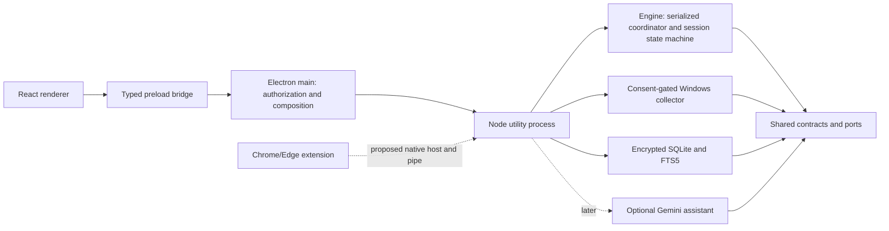
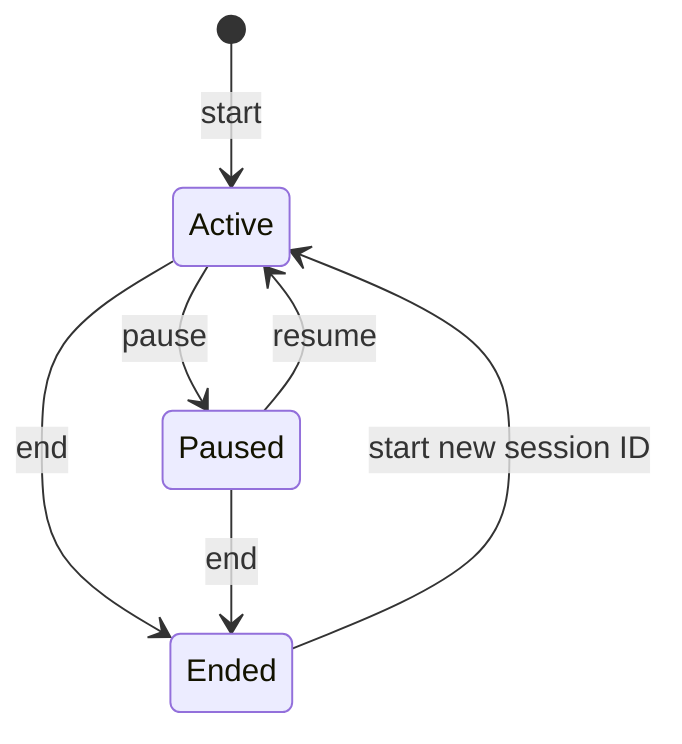
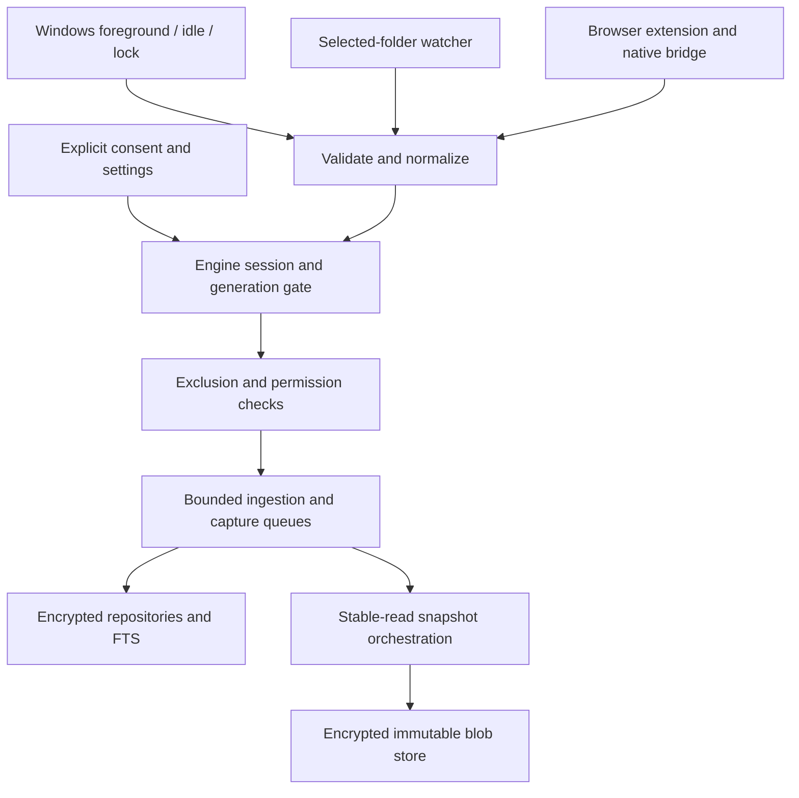

# Architecture

Current core follow-up: [integration report](audit/core-functionality-integration.md) and [ADR 0013](decisions/0013-protected-folder-capture.md) supersede the earlier planned file/retention sections below. The utility now hosts independent consent-gated Windows and protected-folder collectors, transactional encrypted original-byte capture, retained version queries/previews, automatic expiry and explicit deletion/quota controls. Browser transport, recovery execution, checkpoints UI, rich document extraction and AI remain pending. Folder reconciliation uses scoped native handle checks, not path-string watcher authorization.

Current local implementation: [report](audit/secure-storage-collection-integration.md), [ADR 0010](decisions/0010-encrypted-recording-store.md) and [ADR 0011](decisions/0011-recording-worker-consent.md). A supervised utility process hosts the coordinator, encrypted SQLite and Windows collector. Main handles UI/tray, renderer authorization, DPAPI and supervision. Lifecycle commit/drain semantics from ADR 0009 are preserved.

The initialization keeps domain code independent of Electron and React. It uses the approved stack and introduces only dependencies required by the runnable starter. Proposed production mechanisms have explicit implementation gates.

## Components and dependency direction

Solid arrows describe implemented composition; dotted arrows remain planned. Browser/folder collectors, native browser host and cloud requests are unavailable. The old stock-SQLite adapter remains a synthetic repository prototype; production uses only SecureStorage with the pinned cipher and protected key.

| Module            | Allowed responsibility / dependency                                                                                                                                              |
| ----------------- | -------------------------------------------------------------------------------------------------------------------------------------------------------------------------------- |
| contracts         | Platform-neutral types, Zod validation, errors, ports. Depends only on Zod.                                                                                                      |
| engine            | Serialized lifecycle, ingestion authorization, exclusion and drain now; future snapshots, checkpoints, recovery and retention. Contracts/injected ports only, no React/Electron. |
| storage           | SQLite migrations/repositories/FTS, encrypted content store, usage/retention queries. Implements contracts; no dependency on UI/engine internals.                                |
| collectors        | Windows/browser/folder adapters implementing lifecycle/event contracts. No permission to decide when monitoring is allowed.                                                      |
| assistant         | Official Gemini adapter and validated tool loop later. Uses application-approved capabilities and evidence references; no file overwrite capability.                             |
| desktop main      | Window/tray, exact renderer authorization, Windows DPAPI, utility supervision and dialogs. No SQL or window polling.                                                             |
| preload           | Small explicit capability bridge, arguments/responses/event validation. No generic `send`, `invoke`, file API, or raw Electron objects.                                          |
| renderer          | React presentation via DesktopApi. No Node, secrets, database, collector, or privileged file imports.                                                                            |
| browser extension | MV3 background, separate permissions/extraction/transport adapters. No current permissions or monitoring.                                                                        |

Private packages expose TypeScript source bundled by Vite/Vitest. The worker entry lives in desktop composition. `better-sqlite3-multiple-ciphers` 13.1.1 is externalized, copied with its native runtime/license, and its Windows x64 Node-API binary is unpacked from ASAR. Packaged reopen is tested on Electron 44.11.3. SQL/collection never run in main or renderer.

## Electron boundaries

The renderer has `contextIsolation: true`, `sandbox: true`, `nodeIntegration: false`, and web security enabled. Main denies browser permission checks/requests, new windows, navigation, and webviews. The packaged renderer is served only from a registered secure standard `rewind://app` protocol, with bounded asset resolution and a restrictive CSP. Packaged `connect-src 'none'` prevents renderer network access.

The development page uses a loopback Vite server. A per-server nonce permits React Refresh's injected development script; Vite adds that nonce to relevant tags. Development CSS allows inline injection and a loopback WebSocket for HMR. Production adds a stricter response-header CSP with no inline scripts/styles or network connections. Do not broaden production CSP to solve a development issue. [Electron security guidance](https://www.electronjs.org/docs/latest/tutorial/security), [Vite CSP support](https://vite.dev/guide/features#content-security-policy-csp)

The main handler requires the known window's webContents, its exact main frame, and the expected renderer scheme/host/entry path before command validation. Preload validates no-argument public methods and response/event schemas. Main dispatches a strict command enum; errors are small structured values without stacks or sensitive input. Tray commands call the same engine and broadcast resulting state. `get` reads state; events are snapshots, not privileged objects.

Worker messages are versioned, strictly validated and bounded at 2 MiB; IDs and a boot nonce fence replies. Main enforces startup/request deadlines and observes exit before a retry. A heartbeat lease ends orphaned worker authority. Ingestion has a stricter 256 KiB batch limit. Normal quit awaits end/drain/store close; crash recovery restores an interrupted session paused and records a gap, never fabricating an ended acknowledgement. Window close quits; tray-only lifetime is future product work.

## Session lifecycle today

`get` is valid in every healthy state; unlisted transitions return `INVALID_TRANSITION`. Sessions/history persist encrypted. Active alone never grants recording permission. Approval is explicit per worker launch, settings changes pause without automatic resume, and revocation invalidates generation authority before awaiting cleanup. UTC session timestamps are clamped against backward clock changes. Returned objects are copies.

## Planned ingestion

The Windows collector is registered only after secure startup; it samples only after grant plus session activation. One PowerShell helper compiles C# once per run and checks process exclusions before reading titles. Pause/end stop timers, await queries/emits and release the helper. The engine separately rejects stale run/session/source/policy events and drains admitted writes. Browser/file sources are unavailable and lack resource authorization, so cannot be ingested. Idle/lock handling remains unimplemented and is not inferred from a missing foreground window.

Subscribe to selected-folder notifications before baseline capture, stabilize reads, reconcile saves/renames/deletes, and explicitly track baseline completion. Folder events show changes, not user attention. Browser page text is captured at permissioned visit time, as bounded plain text, separately from the URL/title. No page content is executed in privileged processes. Idle and lock observations gate collection according to the approved policy.

## Planned storage, retention, and recovery

SQLite owns normalized records, relationships, versioned transactions/migrations, and FTS5 indexes. The content store owns immutable encrypted original bytes addressed internally by hashes; public FileVersion models contain no blob paths or encryption keys. Text extraction is a derivative for search/preview; a DOCX recovery must preserve the original formatting bytes. Hashes, verified writes, atomic publication, size limits, crash reconciliation, and protected-folder path checks are required.

ADR 0010 selects authenticated SQLCipher-profile metadata encryption with protected key creation, checksummed migrations, schema/FK/SQLite/FTS integrity checks and encrypted WAL. Temporary SQL storage stays in memory. Missing/wrong keys, plaintext, tampering or unavailable encryption fail closed without replacement. Encrypted blobs, key rotation and independent security review remain release work; stock SQLite, ASAR and file permissions are not encryption.

The engine creates recovery proposals from authorized existing file-version IDs. Default recovery writes a new copy after preview and explicit user confirmation. An overwrite additionally preserves and verifies current bytes, checks file identity/hash/mtime against the confirmed target, and aborts if preservation or revalidation fails. Recovery execution is not an assistant tool and is not exposed by current IPC. Reparse points, traversal, destination changes, locked files, corruption, low disk space, and interrupted publication all require tests.

Retention starts at a configurable 72 hours with a proposed 2 GiB quota. Keep pins a checkpoint's transitive files/versions/visits/derived content. Cleanup must cover records, FTS, blobs, previews, queues, extension buffers, logs and transient assistant evidence, with reference counting or equivalent integrity. Kept data exceeding quota needs explicit user feedback and a safe stop policy, not silent loss. SQL deletion alone is not a forensic-erasure guarantee. No retention job exists yet.

## Sources and decision status

See [ADRs](decisions/README.md), [shared contracts](contracts.md), [browser transport/install requirements](browser-integration.md), and [security/privacy](security-privacy.md). The implementation follows the installed Forge 8 Vite plugin's `.cjs` outputs and main/preload/renderer targets. Forge still labels Vite support experimental, so tooling upgrades need the Windows package-and-launch checks. [Forge Vite documentation](https://www.electronforge.io/config/plugins/vite)
