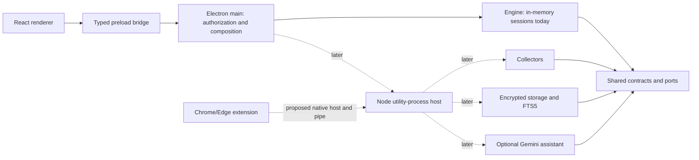
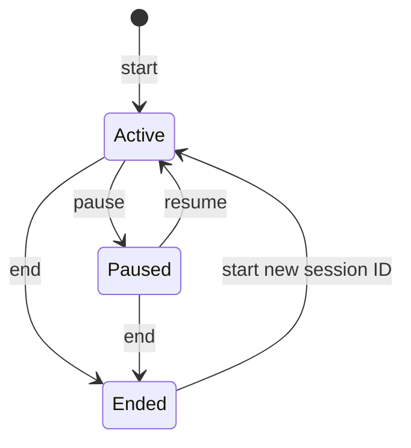
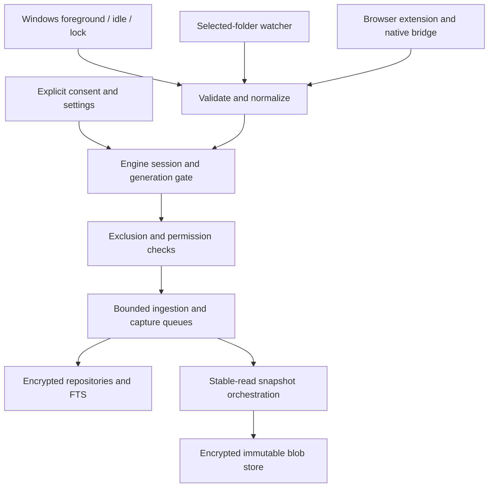

# Architecture

The initialization keeps domain code independent of Electron and React. It uses the approved stack and introduces only dependencies required by the runnable starter. Proposed production mechanisms have explicit implementation gates.

## Components and dependency direction

Solid arrows describe existing calls/dependencies. Dotted arrows are planned runtime integration, with no worker, native host, database, collector, or cloud request currently running.

| Module            | Allowed responsibility / dependency                                                                                                                                                           |
| ----------------- | --------------------------------------------------------------------------------------------------------------------------------------------------------------------------------------------- |
| contracts         | Platform-neutral types, Zod validation, errors, ports. Depends only on Zod.                                                                                                                   |
| engine            | Session lifecycle now; future collection coordination, snapshots, checkpoints, recovery, retention and permissions. Depends on contracts and injected ports; never imports React or Electron. |
| storage           | SQLite migrations/repositories/FTS, encrypted content store, usage/retention queries. Implements contracts; no dependency on UI/engine internals.                                             |
| collectors        | Windows/browser/folder adapters implementing lifecycle/event contracts. No permission to decide when monitoring is allowed.                                                                   |
| assistant         | Official Gemini adapter and validated tool loop later. Uses application-approved capabilities and evidence references; no file overwrite capability.                                          |
| desktop main      | Privileged composition, BrowserWindow/tray, sender authorization, future utility-process host and dialogs.                                                                                    |
| preload           | Small explicit capability bridge, arguments/responses/event validation. No generic `send`, `invoke`, file API, or raw Electron objects.                                                       |
| renderer          | React presentation via DesktopApi. No Node, secrets, database, collector, or privileged file imports.                                                                                         |
| browser extension | MV3 background, separate permissions/extraction/transport adapters. No current permissions or monitoring.                                                                                     |

All private packages expose TypeScript source and are bundled by Vite/Vitest. There are no separate package emit steps or alias-only imports that fail after packaging. Runtime desktop code is bundled, and its workspace/React dependencies are build dependencies. Introduce native dependencies only in privileged package manifests and externalize them from Vite when the native spike proves Forge packaging, ABI rebuild, and ASAR unpack behavior. No database binding is selected by this initialization.

## Electron boundaries

The renderer has `contextIsolation: true`, `sandbox: true`, `nodeIntegration: false`, and web security enabled. Main denies browser permission checks/requests, new windows, navigation, and webviews. The packaged renderer is served only from a registered secure standard `rewind://app` protocol, with bounded asset resolution and a restrictive CSP. Packaged `connect-src 'none'` prevents renderer network access.

The development page uses a loopback Vite server. A per-server nonce permits React Refresh's injected development script; Vite adds that nonce to relevant tags. Development CSS allows inline injection and a loopback WebSocket for HMR. Production adds a stricter response-header CSP with no inline scripts/styles or network connections. Do not broaden production CSP to solve a development issue. [Electron security guidance](https://www.electronjs.org/docs/latest/tutorial/security), [Vite CSP support](https://vite.dev/guide/features#content-security-policy-csp)

The main handler requires the known window's webContents, its exact main frame, and the expected renderer scheme/host/entry path before command validation. Preload validates no-argument public methods and response/event schemas. Main dispatches a strict command enum; errors are small structured values without stacks or sensitive input. Tray commands call the same engine and broadcast resulting state. `get` reads state; events are snapshots, not privileged objects.

Main temporarily hosts the lightweight synchronous session engine. There is no background workload to offload yet. New persistent/collector workloads will move behind a utility-process transport; process creation/restart/error handling lives in desktop main while engine logic remains platform-neutral. This is an explicit staging choice, not a change to the approved Node utility-process architecture. UI closure currently quits the starter. Product tray-only operation needs durable lifecycle and shutdown semantics first.

## Session lifecycle today

`get` is valid in every state; all other unlisted transitions return `INVALID_TRANSITION` without mutation. An ended session remains visible until a new start. UTC wall-clock timestamps are clamped within a session against backward clock changes; durations will require a monotonic clock in the real collector engine. Returned objects are copies. State disappears on app exit. There is no persistence, protection, or monitoring implied by Active.

## Planned ingestion

Collectors must stop emitting and release handles on pause/stop. Engine ingestion must additionally reject a stale generation, paused/ended session, invalid session linkage, excluded resources, or revoked permission. Pause/end acknowledgement must follow queue quiescence; delayed file notifications or extension reconnects cannot silently re-enable capture. Collector/worker failures become explicit gaps. No collectors are registered today, so these guarantees remain acceptance criteria for Phase 1 rather than a claimed implementation.

Subscribe to selected-folder notifications before baseline capture, stabilize reads, reconcile saves/renames/deletes, and explicitly track baseline completion. Folder events show changes, not user attention. Browser page text is captured at permissioned visit time, as bounded plain text, separately from the URL/title. No page content is executed in privileged processes. Idle and lock observations gate collection according to the approved policy.

## Planned storage, retention, and recovery

SQLite owns normalized records, relationships, versioned transactions/migrations, and FTS5 indexes. The content store owns immutable encrypted original bytes addressed internally by hashes; public FileVersion models contain no blob paths or encryption keys. Text extraction is a derivative for search/preview; a DOCX recovery must preserve the original formatting bytes. Hashes, verified writes, atomic publication, size limits, crash reconciliation, and protected-folder path checks are required.

The encryption-enabled SQLite build, key lifecycle, journal/temp/FTS coverage, and encrypted blob format need a packaged Windows spike and Rasit's approval before storing real history. Never treat stock SQLite, Electron ASAR, OS file permissions, or a privacy label as encrypted storage. Release must fail closed when encryption/key services are unavailable.

The engine creates recovery proposals from authorized existing file-version IDs. Default recovery writes a new copy after preview and explicit user confirmation. An overwrite additionally preserves and verifies current bytes, checks file identity/hash/mtime against the confirmed target, and aborts if preservation or revalidation fails. Recovery execution is not an assistant tool and is not exposed by current IPC. Reparse points, traversal, destination changes, locked files, corruption, low disk space, and interrupted publication all require tests.

Retention starts at a configurable 72 hours with a proposed 2 GiB quota. Keep pins a checkpoint's transitive files/versions/visits/derived content. Cleanup must cover records, FTS, blobs, previews, queues, extension buffers, logs and transient assistant evidence, with reference counting or equivalent integrity. Kept data exceeding quota needs explicit user feedback and a safe stop policy, not silent loss. SQL deletion alone is not a forensic-erasure guarantee. No retention job exists yet.

## Sources and decision status

See [ADRs](decisions/README.md), [shared contracts](contracts.md), [browser transport/install requirements](browser-integration.md), and [security/privacy](security-privacy.md). The implementation follows the installed Forge 8 Vite plugin's `.cjs` outputs and main/preload/renderer targets. Forge still labels Vite support experimental, so tooling upgrades need the Windows package-and-launch checks. [Forge Vite documentation](https://www.electronforge.io/config/plugins/vite)
