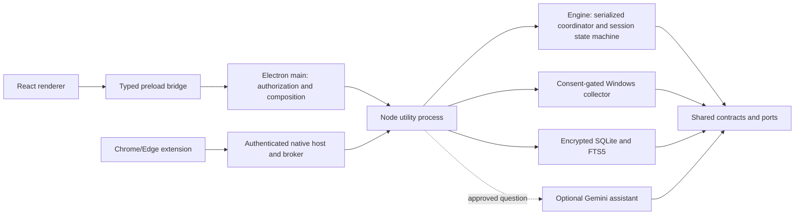
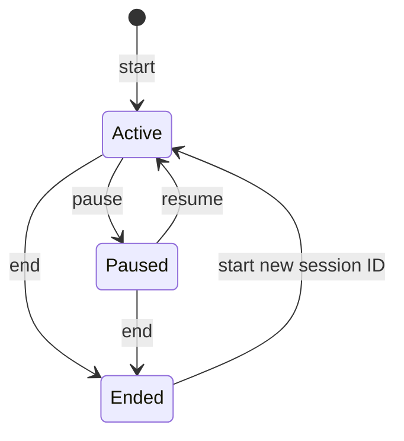
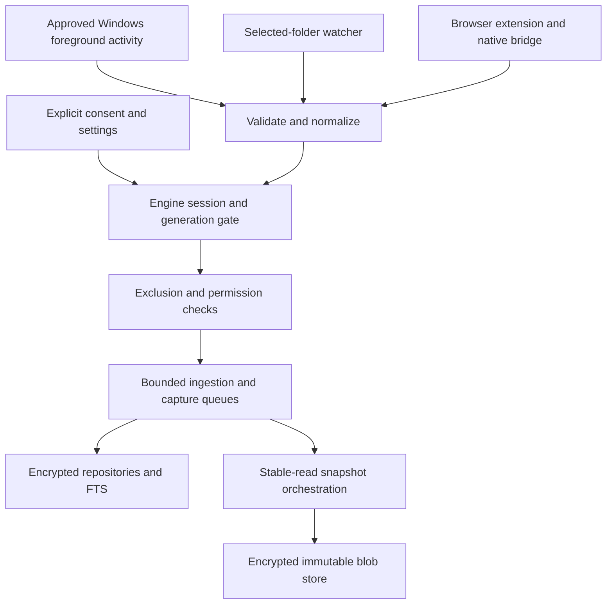

# Architecture

ADRs 0034–0035 now compose encrypted captured-content search in the normal recording worker and Search screen. Derived text/hash/format/limits live in the verified cipher database with source-bound FTS and cascade lifetime; publication rechecks current original identity/bytes, policy and physical quota. `ContentOperations` admits automatic active-session/file-grant work and explicit retained-history backfill, one source at a time. The existing private processor preserves guarded PDF/DOCX limits and preview priority; owner-scoped stop cannot cancel a replacement. Visible status/Stop/retry and escaped version-linked results use document receipts and pre-commit source-specific invalidation. Pending work settles outside the coordinator before storage closes. Gemini remains metadata-only. The current check passes 616 tests / 69 files; final packaged validation is recorded in the core report. Earlier implementation-stage descriptions below are historical where superseded by these ADRs.

Normal Files/Checkpoints now use a distinct single-use document utility (ADRs 0031–0033). The recording worker reads verified retained original bytes, main mediates a private bounded binary request, and a pre-admission Windows Job Object plus external supervisor contain parser resources/lifetime. Parsing releases the coordinator queue; publication requires fresh retained-byte/hash checks and a current document generation/revision receipt. Explicit maintenance confirms parser closure, automatic cleanup fences affected sources before commit, and request-specific cancellation cannot stop a newer screen. Recovery destination selection uses metadata independently of parsing. Extracted text is ephemeral and remains excluded from Gemini; separately searchable extracted content is still a specification gap under review.

Normal Settings/Search now compose the optional assistant through typed preload capabilities and main-owned sealed native credential entry (ADR 0030). A separate launch grant and explicit per-question evidence review authorize bounded official-SDK calls in the utility. Generation/revision/expiry fencing clears stale UI evidence and exposes actual outstanding work. Packaged verification uses a fixed offline provider inside marked synthetic profiles; interactive native entry and live-account compatibility remain manual acceptance gates. Older implementation-stage notes below retain their historical scope.

The utility now composes private assistant credentials, engine source reviews and the official SDK under separate launch consent (ADR 0029). Current privacy/storage/checkpoint changes invalidate active authority; SDK work must actually close before replacement or storage shutdown. Main/native public routing and Search controls remain unfinished, so ordinary cloud use is still unavailable.

Engine-owned assistant sharing reviews now select actual retained activity IDs and expose immutable bounded excerpts for explicit subset approval (ADR 0028). Private disclosure leases revalidate source identity, policy and checkpoint-aware wall/monotonic retention; actual maintenance writes offer synchronous invalidation before commit. Utility/model and public Search composition remain in progress.

Private Gemini credential primitives now use the cipher database and a two-minute native-to-utility sealed entry channel (ADR 0027). Main receives public/sealed metadata only. They are not yet wired to normal public controls; engine review/permission/Search composition remains required.

The conditional assistant now has a private approved-evidence SDK service (ADR 0025), with strict read-only tools, typed citations, current-approval/source checks and bounded/cancellable transport. It is not yet composed into normal desktop cloud controls; credential/review/Search integration remains required. Tooling security updates and the remaining unpatched development advisory are recorded in ADR 0026.

Current recovery composition also includes optional explicitly confirmed overwrite with current target proof, exclusive admission and verified preservation before mutation; [ADR 0024](decisions/0024-confirmed-overwrite-preservation.md) governs this workflow and its interrupted-write limits. Core checks pass 410 unit tests, 16 packaged tests and 6 installed-browser tests.

Current desktop browser composition is implemented locally under [ADR 0023](decisions/0023-desktop-browser-composition.md): private boot assets, utility-owned setup/registration/broker, independent browser consent, exact engine admission and encrypted timeline/search. The real packaged UI passes isolated Chrome and Edge flows. Startup remains passive and approvals expire on restart. Earlier follow-up entries below describe their historical implementation stages.

Browser setup ownership follow-up: [ADR 0022](decisions/0022-durable-browser-setup.md) adds the encrypted revision-checked journal, verified CREATE_NEW installation generations and confirmed setup/repair orchestration. Startup remains read-only and collection approvals remain separate. Worker/private bootstrap and public browser controls are still being integrated.

Browser packaging follow-up: [ADR 0021](decisions/0021-browser-assets-and-owned-registration.md) adds precompiled Windows x64 host assets and the normal extension outside ASAR, bounded inventory/hash verification and an owned per-user registration primitive. Building does not register a host. Receipt-backed installation, worker wiring and public browser controls remain unfinished.

Browser client follow-up: [ADR 0020](decisions/0020-extension-consent-controls.md) records the normal MV3 background/popup, default-off execution, explicit approval, browser-context/frame controls and actual encrypted browser tests. Native/engine components are implemented; owned desktop setup/registration and worker/public UI composition remain in progress, so normal app browser recording is still unavailable.

Current core follow-up: [integration report](audit/core-functionality-integration.md), [ADR 0013](decisions/0013-protected-folder-capture.md) and [ADR 0014](decisions/0014-confirmed-recovery-copies.md) supersede the earlier planned file/retention sections below. The utility now hosts independent consent-gated Windows and protected-folder collectors, transactional encrypted original-byte capture, retained version queries/previews, automatic expiry and explicit deletion/quota controls. Engine-owned expiring confirmation authorizes a verified native new-file recovery copy through a main-owned dialog. Named checkpoints pin actual same-session versions/activity with transitive Keep, verified views and management (ADR 0015). Browser transport, overwrite recovery, rich document extraction and AI remain pending. Folder reconciliation uses scoped native handle checks, not path-string watcher authorization.

Current local implementation: [report](audit/secure-storage-collection-integration.md), [ADR 0010](decisions/0010-encrypted-recording-store.md) and [ADR 0011](decisions/0011-recording-worker-consent.md). A supervised utility process hosts the coordinator, encrypted SQLite and Windows collector. Main handles UI/tray, renderer authorization, DPAPI and supervision. Lifecycle commit/drain semantics from ADR 0009 are preserved.

The initialization keeps domain code independent of Electron and React. It uses the approved stack and introduces only dependencies required by the runnable starter. Proposed production mechanisms have explicit implementation gates.

## Components and dependency direction

The dashed assistant path is implemented but requires separate cloud approval and per-question evidence review. Windows, selected-folder and browser collectors require independent approval and an active session. Article extraction and idle/lock collection remain unavailable. The old stock-SQLite adapter remains a synthetic repository prototype; the verified feature branch uses only SecureStorage with the pinned cipher and protected key. Remote main's prototype composition is not an approved replacement.

| Module            | Allowed responsibility / dependency                                                                                                                                           |
| ----------------- | ----------------------------------------------------------------------------------------------------------------------------------------------------------------------------- |
| contracts         | Platform-neutral types, Zod validation, errors, ports. Depends only on Zod.                                                                                                   |
| engine            | Serialized lifecycle, ingestion authorization, exclusion/drain, snapshot orchestration, checkpoints and confirmed recovery. Contracts/injected ports only, no React/Electron. |
| storage           | SQLite migrations/repositories/FTS, encrypted content store, usage/retention queries. Implements contracts; no dependency on UI/engine internals.                             |
| collectors        | Windows/browser/folder adapters implementing lifecycle/event contracts. No permission to decide when monitoring is allowed.                                                   |
| assistant         | Official Gemini SDK over immutable approved evidence, bounded read-only tools, real source citations and observed cancellation; no recovery/deletion authority.               |
| desktop main      | Window/tray, exact renderer authorization, Windows DPAPI, utility supervision and dialogs. No SQL or window polling.                                                          |
| preload           | Small explicit capability bridge, arguments/responses/event validation. No generic `send`, `invoke`, file API, or raw Electron objects.                                       |
| renderer          | React presentation via DesktopApi. No Node, secrets, database, collector, or privileged file imports.                                                                         |
| browser extension | MV3 background/popup, tabs/nativeMessaging/storage permissions, explicit memory-only consent and focused regular-tab metadata.                                                |

Private packages expose TypeScript source bundled by Vite/Vitest. The worker entry lives in desktop composition. `better-sqlite3-multiple-ciphers` 13.1.1 is externalized, copied with its native runtime/license, and its Windows x64 Node-API binary is unpacked from ASAR. Packaged reopen is tested on Electron 44.11.3. SQL/collection never run in main or renderer.

## Electron boundaries

The renderer has `contextIsolation: true`, `sandbox: true`, `nodeIntegration: false`, and web security enabled. Main denies browser permission checks/requests, new windows, navigation, and webviews. The packaged renderer is served only from a registered secure standard `rewind://app` protocol, with bounded asset resolution and a restrictive CSP. Packaged `connect-src 'none'` prevents renderer network access.

The development page uses a loopback Vite server. A per-server nonce permits React Refresh's injected development script; Vite adds that nonce to relevant tags. Development CSS allows inline injection and a loopback WebSocket for HMR. Production adds a stricter response-header CSP with no inline scripts/styles or network connections. Do not broaden production CSP to solve a development issue. [Electron security guidance](https://www.electronjs.org/docs/latest/tutorial/security), [Vite CSP support](https://vite.dev/guide/features#content-security-policy-csp)

The main handler requires the known window's webContents, its exact main frame, and the expected renderer scheme/host/entry path before command validation. Preload validates no-argument public methods and response/event schemas. Main dispatches a strict command enum; errors are small structured values without stacks or sensitive input. Tray commands call the same engine and broadcast resulting state. `get` reads state; events are snapshots, not privileged objects.

Worker messages are versioned, strictly validated and bounded at 2 MiB; IDs and a boot nonce fence replies. Main enforces startup/request deadlines and observes exit before a retry. A heartbeat lease ends orphaned worker authority. Ingestion has a stricter 256 KiB batch limit. Normal quit awaits end/drain/store close; crash recovery restores an interrupted session paused and records a gap, never fabricating an ended acknowledgement. Window close quits; tray-only lifetime is future product work.

## Session lifecycle today

`get` is valid in every healthy state; unlisted transitions return `INVALID_TRANSITION`. Sessions/history persist encrypted. Active alone never grants recording permission. Approval is explicit per worker launch, settings changes pause without automatic resume, and revocation invalidates generation authority before awaiting cleanup. UTC session timestamps are clamped against backward clock changes. Returned objects are copies.

## Ingestion

The Windows collector is registered only after secure startup; it samples only after grant plus session activation. One PowerShell helper compiles C# once per run and checks process exclusions before reading titles. Pause/end stop timers, await queries/emits and release the helper. The engine separately rejects stale run/session/source/policy events and drains admitted writes. Selected-folder capture verifies current Windows identities and original bytes. Browser ingestion requires native-proven peers and exact staged event authorization; neither a path record nor a browser assertion is an authorization token. Idle/lock handling remains unimplemented and is not inferred from a missing foreground window.

Selected folders are reconciled on bounded polling with an initial baseline and periodic full reconciliation; progress and failures are visible. Folder events show saved changes, not user attention, and brief intermediate saves can be missed. Browser capture contains focused regular-tab URL/title metadata only, with exclusions and query/fragment redaction. Article extraction and idle/lock handling are unavailable. Captured markup is never executed.

## Storage, retention, and recovery

SQLite owns normalized records, relationships, versioned transactions/migrations, and FTS5 indexes. The content store owns immutable encrypted original bytes addressed internally by hashes; public FileVersion models contain no blob paths or encryption keys. Text extraction is a derivative for search/preview; a DOCX recovery must preserve the original formatting bytes. Hashes, verified writes, atomic publication, size limits, crash reconciliation, and protected-folder path checks are required.

ADR 0010 selects authenticated SQLCipher-profile metadata encryption with protected key creation, checksummed migrations, schema/FK/SQLite/FTS integrity checks and encrypted WAL. Temporary SQL storage stays in memory. Missing/wrong keys, plaintext, tampering or unavailable encryption fail closed without replacement. Original bytes are stored in the same encrypted database as immutable hash-verified BLOBs. Key rotation and independent security review remain release work; stock SQLite, ASAR and file permissions are not encryption.

The engine creates expiring single-use recovery-copy proposals from actual retained file-version IDs and a main-owned native destination dialog. Confirmation rechecks the source and current native parent identity, writes only a new file and verifies complete bytes. Existing destinations are rejected. Narrow public IPC exposes choose/confirm/cancel, never arbitrary filesystem access. Recovery execution is not an assistant tool. Optional overwrite now has separate native selection, expiring explicit confirmation, current identity/hash/write-time checks and exclusive handle/oplock admission. Before mutation, it flushes and verifies a new ordinary preservation file in the chosen folder; output is verified through the held target handle. Failed prerequisites leave the target unchanged; an interrupted write may require recovery from its preserved copy. This is not an atomic replacement or a power-loss transaction. ADR 0024 records rollback and shutdown limits.

Retention defaults to 72 hours and is configurable from 1 to 8760 hours. Physical usage and configurable quota include the encrypted database and journals. Startup, retrieval and periodic cleanup expire unkept evidence; bounded pressure eviction preserves kept checkpoint references and denies new capture if sufficient space cannot be recovered. Explicit cleanup/deletion pauses and drains sources and revokes launch approvals. Settings exposes actual usage, policy and confirmed deletion, with separate inclusion of kept evidence. Session shells, privacy settings and operational setup receipts remain. SQL deletion/compaction does not promise forensic erasure or a hard filesystem quota.

## Sources and decision status

See [ADRs](decisions/README.md), [shared contracts](contracts.md), [browser transport/install requirements](browser-integration.md), and [security/privacy](security-privacy.md). The implementation follows the installed Forge 8 Vite plugin's `.cjs` outputs and main/preload/renderer targets. Forge still labels Vite support experimental, so tooling upgrades need the Windows package-and-launch checks. [Forge Vite documentation](https://www.electronforge.io/config/plugins/vite)
