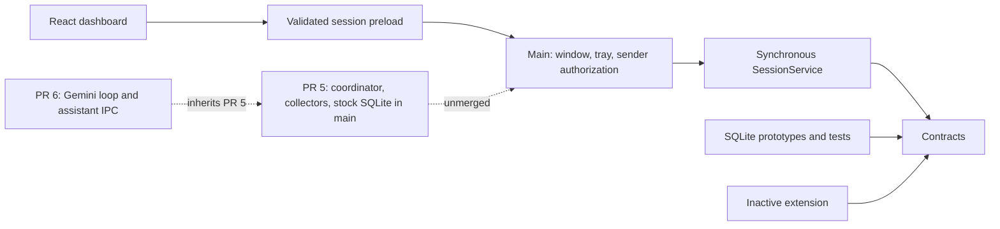
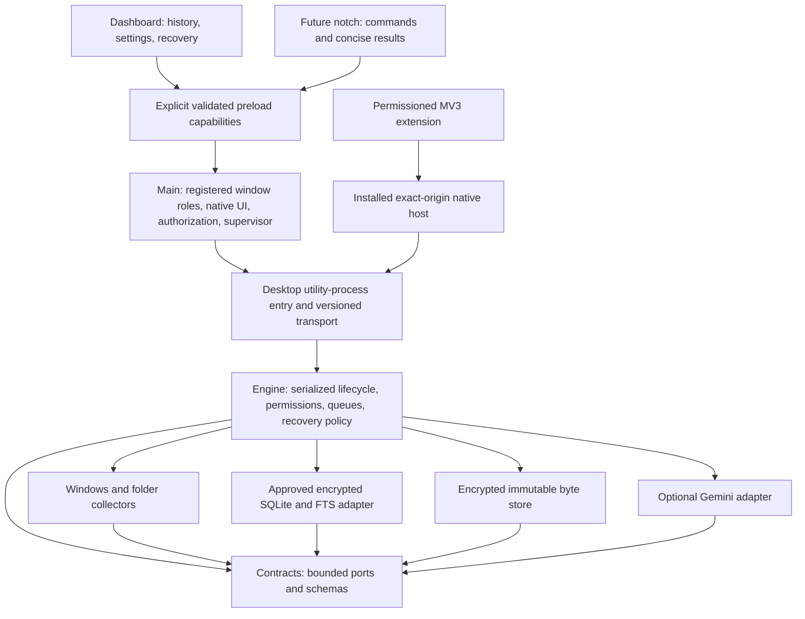

# Architecture improvement plan

This is a proposal, not implemented architecture. Preserve the npm-workspace/Electron/React/TypeScript/Vite/Forge stack and current security controls. All substantive contracts, native dependencies, encryption, recovery and lifetime decisions below **need Rasit's approval**. [Findings](findings.md) supply evidence; [roadmap](development-roadmap.md) supplies owned tasks.

## Current relationships

The baseline separation is useful and should remain. Its synchronous session service has no background workload. The proposed PR integrations add slow/privileged work to main, ignore failures, and depend on lifecycle promises they do not implement. Do not rewrite the monorepo to solve these specific problems.

## Recommended target and boundaries

The diagram shows desired calls and boundaries, not permission to implement all of them now. Worker entry points and Electron-specific process creation stay under `apps/desktop/src/main`; packages remain testable without Electron. Infrastructure implements contracts, never renderer imports. Assistant consumes authorized evidence ports rather than direct unrestricted repositories. Both UI surfaces use the same engine, never separate session state or storage.

| Module                | Keep                                                                                       | Incremental change                                                                                                                                           |
| --------------------- | ------------------------------------------------------------------------------------------ | ------------------------------------------------------------------------------------------------------------------------------------------------------------ |
| Main                  | Window/tray, strict sender/frame/location checks, native dialogs, restrictive protocol/CSP | Extract registered role authorization and utility supervision only when adding the host/second window. Keep unrelated native responsibilities out of engine. |
| Preload               | Explicit methods, argument/result/event schemas, unsubscribe                               | Add capabilities only after approved contracts. No raw IPC, generic FS/SQL, BrowserWindow, model SDK or secrets.                                             |
| Renderer              | Presentational shell and live session behavior                                             | Extract a small typed session client/hook and screen components with tests. Share that client with notch; avoid introducing a dependency framework.          |
| Engine                | Deterministic SessionService and injected environment                                      | Plan/commit transitions and serialize orchestration behind ports. Track generation, active operations, consent version and publication state.                |
| Collectors            | Injected strategies and event normalization                                                | Emit observations and health/gaps only when authorized; do not grant consent, choose persistence mode or invent resource identities.                         |
| Storage               | Parameterized SQL, foreign-key work, #4 validation patterns                                | One versioned migration source, encrypted adapter, validated records, deterministic query cursors, atomic evidence relationships.                            |
| Assistant             | Read-only tool concept and official SDK direction                                          | Scoped engine evidence access, typed citations, budgets, cancellation and separately approved cloud sharing. No execute/confirm recovery capability.         |
| Extension/native host | Inactive permission-free starter and documented adapter seams                              | Exact origins, authenticated bounded ingress, fresh generation handshake, explicit optional site extraction.                                                 |

## Refactor proposals and migration safety

### 1. Reliable lifecycle before further integrations

**Scope:** `packages/engine/src/{session-service,session-coordinator}.ts`, approved contracts, desktop host/IPC, synthetic tests. Dependencies: agreed failure/consent policy and storage capabilities. Owner: Rasit.

1. Define the externally observable commit point for each action and collection health separately from session status. A session can be active without collection; neither consent nor durability follows from that word.
2. Preserve the pure transition behavior; create candidate state without immediately publishing it. Serialize lifecycle commands and the relevant read/publication snapshots. A coordinator must not commit an earlier start after a later stop has acknowledged.
3. Check every repository/collector Result. Choose a documented compensation state when only part of startup succeeds; recommended default is stop everything started, invalidate generation, report failure/gap and avoid publishing recording success. Durable storage failure must not become volatile success.
4. Issue fresh, non-reused generation and consent-version capabilities only after the engine has the necessary permission and storage readiness. Worker restart never grants new consent or resumes capture automatically.
5. On pause/end/revoke: invalidate authorization first, stop subscriptions, quiesce or cancel queued work, await in-flight append/capture operations, persist the stopped state as specified, then acknowledge. Revalidate at queue admission and immediately before commit, not only before an asynchronous await.
6. Bound batch count, encoded size, pending work and execution time. Derive initial limits from synthetic burst tests and measurements; do not treat five model rounds or a debounce timer as a complete resource budget.
7. Main's async quit must prevent default once, request a bounded stop/drain/close acknowledgement, and quit only through a guarded completion path. Define visible failure/timeout behavior; do not leave unresolved writes hidden behind an ended label.

**Risk:** changing when state becomes visible affects UI/tray and storage recovery. **Rollback:** keep the original in-memory composition selectable for fixture-only shell testing, without silently falling back to it after durable-mode failure. **Verification:** run the four preserved coordinator probes first, then startup/partial startup/save/stop failure, overlapping actions, revocation during append, worker death, timeout, stale generation and restart tests. No real collector is needed to prove these guarantees.

### 2. Utility host and process supervision

**Scope:** desktop utility entry/transport and engine composition; no renderer/native dependencies in packages. Electron's [utilityProcess API](https://www.electronjs.org/docs/latest/api/utility-process) provides a Node-capable child and message ports. This is appropriate for approved background services, not a reason to add an idle worker to the current shell.

Define a versioned ready/error/request/ack protocol with request IDs, bounded messages, schema validation, generation/consent version and child-liveness handling. Main authorizes UI requests before forwarding; engine authorizes resources again. Worker crashes produce an explicit unavailable/gap state, discard obsolete capabilities, and require a new approved handshake. Keep bounded extraction jobs separate from the command/event loop if parser timeouts cannot be safely enforced in-process.

**Risk:** distributed shutdown/restart ordering. **Rollback:** revert the composition entry and contract as one reviewed PR; never re-enable monitoring on crash recovery. **Verification:** synthetic child crash, malformed/version-skewed message, duplicate acknowledgement, stop during ready/start, hung child, and packaged worker-path tests.

### 3. Storage/migrations and the encryption gate

**Scope:** `packages/storage`, `db`, desktop packaging/resources and key port. Mohammed owns repositories; Rasit owns authorization/key policy. Keep stock SQLite confined to generated fixtures until an encrypted adapter is proven.

- Make versioned migrations authoritative. Retain `schema.sql` only as a generated/documented view; remove the need to maintain #5's independent embedded copy after review. Do not mutate an already-applied migration to upgrade deployed databases.
- Validate unique numeric ordering, supported schema version and checksums; apply each migration plus version record atomically. Reject missing resources, future/duplicate versions and malformed SQL. Resolve resources from the packaged app, not cwd-dependent path guesses.
- Keep initialization all-or-failure, idempotent where documented, and close partially opened handles. Distinguish metadata size, WAL/journal bytes, blob bytes and kept/transitive usage; SUM(file_version.byte_length) is neither real disk consumption nor a quota implementation.
- Prove an exact encryption-enabled SQLite/FTS5 build, key protection and authenticated blob format against the actual Electron runtime. Test WAL/temp/index coverage, wrong/missing keys, tamper, reopen, crash and package ABI. Stock `node:sqlite` and ASAR are not substitutes. Do not choose an unverified native binding solely because ordinary Node tests pass.
- Validate domain data on write/hydration, relational membership and immutable version identities. Browser visits/resources need referentially enforceable IDs before checkpoint pins, local recall and AI citations depend on them.

**Risk:** schema/key formats can strand user data. **Rollback:** immutable numbered migrations, synthetic compatibility fixtures, pre-migration preservation under the approved encrypted design, and refusal of unsupported newer schemas. Do not downgrade or copy plaintext as a rescue shortcut. **Verification:** failure/reopen fixtures, upgrade/downgrade refusal, all repository integrity tests and a real packaged encrypted round trip before real history.

### 4. Query/evidence architecture and FTS migration

Keep local keyword/date retrieval independent of Gemini. First repair LIKE prototype semantics: no fabricated file-version ID, correct session/time filtering, typed resolvable sources, literal/wildcard policy, bounded results and composite cursors. A parameterized LIKE query is not SQL injection, but `%`/`_` broadening and raw JSON/path excerpts still need explicit behavior.

Then introduce FTS5 through a numbered migration, with authorized source IDs, transactionally synchronized index rows and a rebuild/backfill plan. Apply access/expiry/exclusion filters before ranking/output; deleting the metadata row must not leave retrievable derived content. Bound MATCH expressions and test malformed query syntax, punctuation, Unicode, huge queries, equal timestamps, latest-within-session and excluded/expired results. No vector database or semantic search is needed for the first reliable slice.

**Risk:** changing source kinds/cursors breaks consumers. **Rollback:** version narrow contracts and keep the previous query adapter only for synthetic comparison, not as an unauthorized retrieval bypass. **Verification:** saved recall fixtures with ground-truth source resolution and the preserved search probes; query-plan/large-fixture measurement before publishing performance claims.

### 5. Windows and folder collector migration

Keep the current strategy injection and synthetic emit fixtures. The local `$PID` correction fixes a real script defect but does not certify native capture. Compare the corrected PowerShell prototype with [get-windows](https://github.com/sindresorhus/get-windows) in an explicit opt-in harness. Measure child startup/compilation cost, sampling delay, idle CPU and shutdown behavior before choosing the production adapter. Test the native dependency in Forge against the exact Electron ABI. Add idle/lock only as a later approved capability.

Folder notifications are hints for an engine-owned reconciliation/capture queue. Reuse normalization/debounce concepts but replace fresh random file IDs with authorized stable identity resolution. Watch only selected canonical roots; check exclusions by path components, reparse points, file identity and destination at use time. Handle rename/atomic save/delete/overflow/restart explicitly. Do not assume `fs.watch` is a complete durable save log; evaluate the planned `@parcel/watcher` adapter through a packaged spike.

**Risk:** silently widening capture or misidentifying files. **Rollback:** keep collection disabled and report unsupported/gaps, rather than launching a less safe fallback. **Verification:** mocked native boundaries plus a separately consented Windows matrix; no ordinary CI test may depend on a user's actual foreground title or files.

### 6. File capture and recovery technical design

No recovery code is added by this audit. Recommended implementation order:

1. Approve supported file types, per-file/total quotas, canonical protected roots, Windows file identity/reparse policy and cryptographic key/blob format.
2. Subscribe to allowed roots before baseline enumeration; reconcile concurrent signals and expose baseline pending/complete/failed status. No protection claim until the relevant snapshot is durably verified.
3. Stabilize reads with bounded retry/time/size checks and before/after identity/mtime/size checks. Preserve complete **original bytes**, including DOCX formatting. PDF.js/Mammoth text is only a derivative and runs in bounded jobs; unsupported/image-only/locked/encrypted documents produce a gap.
4. Hash bytes with SHA-256, encrypt/authenticate into a temporary store entry, verify durable publication, then atomically publish metadata referring to the immutable blob. Reconcile interrupted blob/metadata publication after restart. Dedup/pins must preserve confidentiality and reference integrity.
5. Query only successfully captured versions. A file reference or change event must never appear as a recoverable version merely because its UUID validates.
6. Create an engine-owned, expiring, single-use proposal bound to version/hash, mode, destination and current target identity. Main obtains native destination choice; renderer/model supply approved IDs, not arbitrary authorized paths.
7. Preview with safe plain text or supported bounded rendering. Save a new recovered copy by default. Require explicit user confirmation of the concrete operation; model-generated intent is not confirmation.
8. Before overwrite, successfully preserve and hash-verify current bytes in the approved safety store, then revalidate target identity/content immediately before a tested Windows replacement operation. Locked/reparsed/concurrently changed targets, integrity errors or failed preservation abort. No fallback to truncating the original.
9. Verify recovered output and record the result; reconcile crashes between preservation, staging, replacement and acknowledgement. Clean temporary previews/staging under the documented retention policy. An explicitly recovered user destination is distinct from Rewind's encrypted private snapshot store.

**Required tests:** baseline races, unsupported/oversized files, rapid and atomic saves, original-byte equality, hash/key tamper, disk full, interrupted publication, symlink/junction escape, stale proposal, duplicate confirmation, target changes, locks, failed safety copy and crash recovery. **Risk:** high data loss; approve the design before engine implementation. **Rollback:** preserve current files and immutable captured blobs, stop capture/recovery on uncertainty and retain an auditable failed operation; never execute an unverified overwrite.

### 7. Checkpoints, retention and deletion

A checkpoint is a manifest of actual version/visit/project IDs and capture outcomes, not process memory. Decide whether requesting one captures current files or selects known versions, and disclose partial outcomes. Keep must pin its transitive immutable artifacts; deletion/unkeep must release only no-longer-referenced data. Protect kept artifacts from session cascades, reconcile orphans and account for shared blobs.

Retention/deletion spans records, FTS, blobs, previews/temp/safety copies, queue buffers, extension state and assistant evidence caches. Enforce the configured 72-hour default and quota only after an approved cross-store policy exists. Never promise forensic erasure or provider-side deletion. Test restart halfway through cleanup, kept-over-quota behavior and disappearance from every retrieval route.

### 8. Secure browser transport and article extraction

The inactive extension is a useful safe baseline. Prove the proposed native host before adding listeners. [Chrome Native Messaging](https://developer.chrome.com/docs/extensions/develop/concepts/native-messaging) requires a registered native host and uses framed stdio; it is not an attachment to arbitrary Electron Node. [Edge's native messaging guide](https://learn.microsoft.com/en-us/microsoft-edge/extensions/developer-guide/native-messaging) must also be validated on Windows.

Use exact development/store extension origins, per-user installation and authenticated, user-bound bounded pipe ingress into the utility host. Approve how the host authenticates caller/process/session; an origin string or global static readable token alone is not enough. Reject malformed/oversized/version-skewed/replayed messages. Reserve stdout for framing; redact stderr diagnostics.

Collection requires desktop consent, active generation, browser focus, nonprivate/nonrestricted context and exclusions. Article extraction has separate per-site permission and revocation, uses a cloned permitted DOM and bounded plain text, and never executes captured markup in a privileged process. After service-worker/host restart, discard stale buffers and obtain a fresh generation. Install/update/uninstall must maintain both browsers' host registrations without orphans. None of this was installed during the audit.

### 9. Local search and Gemini policy separation

Do not integrate #6 merely by changing its model string. First expose an engine-authorized evidence/query port that applies current session/permission/exclusion/expiry policy. Implement the six approved tool capabilities in dependency order; `search_checkpoints` needs real checkpoint queries and `propose_recovery` needs existing authorized proposals. Recovery execution stays outside the assistant.

Preserve source IDs/time/evidence labels, validate model citations against retrieved records, and derive insufficient-evidence status from observations rather than English substrings. Treat documents/window titles/model output as data that cannot widen permissions. Set call/round/byte/token/concurrency/deadline budgets, clear timers and abort on timeout/revocation. Redact public provider errors and use OS-protected credentials. Validate against the installed official SDK types, not the ambient replacement declaration.

Google's [current model page](https://ai.google.dev/gemini-api/docs/models/gemini-2.0-flash) reports the branch's default model retired. Model choice needs a new availability/cost/recall evaluation at implementation time, rather than freezing today's recommendation in the architecture. See the [official SDK](https://github.com/googleapis/js-genai). No provider request or key configuration is part of this audit.

## Future notch/dashboard design constraints

The current Electron stack can support the requested small top-center horizontal overlay without a rewrite. This is an architecture feasibility conclusion, not a verified notch implementation. The existing singleton authorization, lifetime and broadcasts need a deliberate extension first.

- Register dashboard and notch webContents with explicit roles and capability allowlists; preserve main-frame and location checks for each. Do not weaken the unauthorized-window test into accepting all same-origin windows.
- Share typed session/query/command clients and backend state. Keep the dashboard for detailed timeline/settings/recovery; the notch owns small collapsed/expanded presentation, command input, concise results and navigation to the full view.
- Main owns bounded semantic window actions such as collapse/expand/show-dashboard. Do not expose arbitrary BrowserWindow methods or unrestricted coordinates through preload.
- Use work-area/device-independent coordinates, display metrics and DPI tests; recompute top-center position on monitor removal, scaling and taskbar changes. Specify selected-monitor persistence and offscreen recovery.
- Decide focus rules, keyboard activation, Escape/collapse, screen-reader names/live status, high contrast, reduced motion and a non-hover alternative. Opening a notch must not steal arbitrary application focus or intercept typing while collapsed.
- [Electron BrowserWindow](https://www.electronjs.org/docs/latest/api/browser-window) supports the window mechanisms needed for a prototype, including ignoring mouse events. Click-through and pointer-forwarding settings must be narrowly controlled and tested; an accidentally inert or invisible input window is a UX/security failure.
- Approve always-on-top/fullscreen behavior, taskbar/Alt-Tab visibility, z-order, transparency, animation performance, sleep/wake and multiple desktop behavior on supported Windows versions. Exclude Rewind's own overlay from attention inference to prevent a feedback loop.
- Abdullah owns arrow-mascot/token/motion specifications with Hacer implementing them later. Voice input is a separate optional-consent/microphone/retention decision, not a background feature implied by this audit. No overlay, mascot or voice feature was built.

## Performance and reliability evidence

| Item                       | Classification                                 | Evidence / next measurement                                                                                                                                               |
| -------------------------- | ---------------------------------------------- | ------------------------------------------------------------------------------------------------------------------------------------------------------------------------- |
| Package size               | Measured baseline                              | Packaged folder 385,896,744 bytes; app.asar 431,394 bytes before the small disconnected guard rebuild. This is output size, not installed size/RAM/installer measurement. |
| SQL in main                | Confirmed mechanism; latency impact unmeasured | #5 executes synchronous SQLite from async wrappers in main. Measure bounded burst and large query latency in the proposed utility host.                                   |
| PowerShell per poll        | Confirmed mechanism; cost unmeasured           | Compare synthetic startup latency/idle CPU with get-windows under consented harness. No real monitoring benchmark ran.                                                    |
| In-flight writes/commands  | Reproduced correctness issue                   | Controlled Promises prove races/drain failure; correctness gate precedes performance tuning.                                                                              |
| Watcher backlog            | Likely risk                                    | Map of debounce timers has no cap and every distinct path may add work. Measure burst count/heap/queue gaps on synthetic trees; set approved overflow policy.             |
| Assistant timers/budgets   | Reproduced/confirmed                           | Successful mocked request leaves a timer; no per-round tool-count or overall/concurrency budget. No network load test ran.                                                |
| Repository fixture handles | Confirmed test hygiene defect                  | Baseline fixtures now close after each test; no production file-handle leak rate was measured.                                                                            |

For later benchmarking, version the scenario, fixture size, polling rate, supported Windows build, CPU/RAM/disk, exact binary/commit, duration and excluded roots. Run idle shell, synthetic event bursts, large query corpus, locked/rapid-save recovery, sleep/wake and eight-hour explicit-consent scenarios. Record p50/p95 command/capture latency, queue depth/gaps, CPU, private bytes, disk growth and correctness, then approve budgets. Do not claim the notch or Electron is lightweight solely from package or unit-test timings.

## Windows distribution levels

| Level                        | Current assessment      | Conditions / blockers                                                                                                                                                                                                                                                          |
| ---------------------------- | ----------------------- | ------------------------------------------------------------------------------------------------------------------------------------------------------------------------------------------------------------------------------------------------------------------------------ |
| Shell/session prototype demo | Available locally       | Current package and synthetic tests; clearly state no real capture/recovery. Shared main still lacks the local cleanup/audit fixes.                                                                                                                                            |
| Internal team testing build  | Foundation testing only | Reviewed integration, truthful capabilities, scoped explicit consent, encrypted real-data path, failure-safe lifecycle and packaged adapter evidence before recording real activity. Synthetic-only testing can proceed earlier.                                               |
| Limited beta                 | Not ready               | Supported Windows/browser matrix, signed per-user installer, real capture/recovery/retention correctness, key lifecycle, crash recovery, privacy controls, notices, update/rollback and support diagnostics.                                                                   |
| Public production release    | Not ready               | All version-one acceptance gates, clean-machine install/update/uninstall, exact extension/native-host distribution, signing/update verification, security/accessibility review, approved license/privacy disclosures, dependencies/notices and Rasit's final release approval. |

Forge currently creates a packaged folder or ZIP; no installer, signing configuration, updater or host registration exists. Native dependencies/resources need packaged ABI, rebuild and ASAR checks. Define whether uninstall keeps or deletes user data through explicit user choice; do not silently wipe history or claim external backups/provider logs can be erased. Select application/tray icons and extension store IDs only in the approved distribution work.

## Decisions requiring Rasit

| Decision                              | Preferred direction and reason                                                                                       | Evidence needed before execution                                                                                             |
| ------------------------------------- | -------------------------------------------------------------------------------------------------------------------- | ---------------------------------------------------------------------------------------------------------------------------- |
| D1: storage failure/runtime modes     | Durable mode fails closed; synthetic mode is explicit and never a fallback after durable failure.                    | Lifecycle/public-state contract and failure probes.                                                                          |
| D2: lifecycle commit/partial failure  | Serialized candidate/commit transitions, stop compensation, explicit gaps and drain acknowledgement.                 | Transition matrix, queued-write and quit/crash tests.                                                                        |
| D3: encrypted DB/key/blob format      | Prove one SQLite/FTS5 cipher and authenticated snapshot/key design; no plaintext real-data mode.                     | Exact packaged Windows native/key/journal/tamper/reopen spike and license review.                                            |
| D4: collector/native strategy         | Retain injected ports, evaluate get-windows/@parcel/watcher against measured PowerShell/fs.watch prototype.          | Explicit opt-in native harness, resource/error/ABI evidence.                                                                 |
| D5: identity/recovery/pins            | Engine-owned canonical identities, immutable byte versions, copy default, verified preservation before overwrite.    | Threat model, proposal/pin schema and adversarial capture/recovery tests.                                                    |
| D6: browser transport                 | Exact-origin Native Messaging plus authenticated bounded user pipe.                                                  | Both browser IDs, host/pipe authentication, install/reconnect/uninstall tests.                                               |
| D7: cloud model/credentials/sharing   | Local query works offline; current SDK types, OS-protected user keys, scoped evidence and revocable request budgets. | Model evaluation, data disclosure, prompt-injection/revocation/citation tests.                                               |
| D8: notch/lifetime and release policy | Separate authorized notch/dashboard roles sharing one backend; signed per-user distribution after safety gates.      | UX focus/DPI/accessibility specification, lifetime tests, signing/update/uninstall policy and authoritative project license. |

These decisions are listed for review; the audit does not stop on them or treat them as authorization to implement new features.
