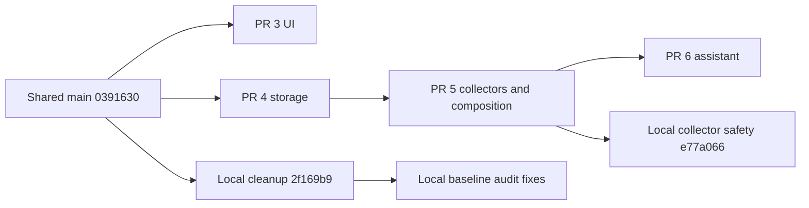

# PR integration plan

**Local follow-up:** `feature/backend-lifecycle-stabilization` selectively adapts the existing coordinator and Windows adapter and corrects related prototype storage/query defects; see [implementation evidence](backend-stabilization.md). Prefer reviewing these bounded repair commits over copying #5's unsafe main/embedded-schema/fallback composition. #4/#5 consumers must adopt SessionStorage, exact-run authorization and composite activity cursors when integrating. Remote PR state below is the audit snapshot; this implementation does not merge, rebase, push or mark those PRs ready. Their encryption/utility/browser/identity gates remain.

Snapshot: 16 November 2026, after a fresh origin fetch and GitHub metadata/CI/review queries. Default branch is `main` at `0391630`. **No merge, push, remote PR/comment, branch deletion or repository setting change was performed.** GitHub text mergeability does not establish semantic correctness or approval.

## Verified branches and pull requests

| Branch / PR                                                                      | Head                                                                                         | State / CI                                         | Purpose and disposition                                                                                                                                  |
| -------------------------------------------------------------------------------- | -------------------------------------------------------------------------------------------- | -------------------------------------------------- | -------------------------------------------------------------------------------------------------------------------------------------------------------- |
| `feature/database-schema`, [#1](https://github.com/abdu3061/Rewind/pull/1)       | `bd80f34`                                                                                    | Merged 27 October; 16 changed files                | SQL/repository prototype. Already in main; do not merge again. Encrypted persistence/retention task acceptance remains incomplete.                       |
| `feature/frontend-ui`, [#2](https://github.com/abdu3061/Rewind/pull/2)           | `1b81d66`                                                                                    | Merged 27 October; 3 changed files                 | Renderer previews/interactions. Main has remnants; earlier local cleanup repairs them.                                                                   |
| `friend-feature`                                                                 | `4bfa033`                                                                                    | Ancestor of main                                   | Original foundation. No unique work to integrate. Preserve its ref.                                                                                      |
| `feature/design-tokens-privacy`, [#3](https://github.com/abdu3061/Rewind/pull/3) | `ba16ceb`                                                                                    | Open/mergeable; CI 37 failed at app tests; 4 files | Visual work worth salvaging; session/privacy simulation is unsafe. Not ready.                                                                            |
| `feature/sqlite-persistence`, [#4](https://github.com/abdu3061/Rewind/pull/4)    | `5824ea1`                                                                                    | Open/mergeable; CI 38 passed; 15 files             | Useful validation/migration/query expansion. Needs failure/query/contract corrections, not approved encrypted runtime.                                   |
| `feature/data-collectors`, [#5](https://github.com/abdu3061/Rewind/pull/5)       | `6114324`                                                                                    | Open/mergeable; CI 45 passed; 34 files             | Includes #4 plus collectors/coordinator/main composition. Lifecycle/authorization blockers.                                                              |
| `feature/gemini-assistant`, [#6](https://github.com/abdu3061/Rewind/pull/6)      | `a91d79d`                                                                                    | Open/mergeable; CI 47 passed; 44 files             | Includes #4/#5 plus provider/tools/IPC. Parent and AI privacy/evidence/compatibility blockers.                                                           |
| Earlier local cleanup                                                            | `2f169b9`                                                                                    | Local only                                         | Cleanup and Electron patch; review before adoption. Do not overwrite with old branch versions.                                                           |
| Audit work                                                                       | `audit/stabilization-2026-11-16`; collector fix `e77a066` on `audit/collector-stabilization` | Local only                                         | Small fixes and audit documents, still requiring Rasit's integration review. Collector fix is a descendant of #5 and is not integrated into baseline/#6. |

Every PR's exact GitHub changed-file list is preserved in [branch-manifest.json](branch-manifest.json). Lists for #5/#6 include inherited work. No submitted GitHub reviews were returned for #3–#6; approval checkboxes are not review submissions. No teammate usernames are inferred.

## Overlap and semantic conflicts

| Files / branches                                                                                        | Resolution needed                                                                                                                                                                 |
| ------------------------------------------------------------------------------------------------------- | --------------------------------------------------------------------------------------------------------------------------------------------------------------------------------- |
| #4/#5/#6 storage repositories/tests, SQL and `contracts/ports.ts`; #5 replaces adapter failure behavior | Preserve #4 validation, remove false persistent success and choose one migration source. Last textual version is not automatically correct.                                       |
| #5/#6 main, desktop manifest and engine/collector contracts                                             | #6 inherits consent override, plaintext DB and shutdown races. Changing a PR base alone does not fix parent semantics.                                                            |
| #3 vs cleanup/audit `App.tsx`, renderer entry and CSS                                                   | Preserve real `window.rewind.sessions` and the missing-preload guard. Port reviewed tokens, not fake deletion/history/session state or inline production styles.                  |
| Open branches vs local desktop manifest/lockfile                                                        | Preserve tested Electron 44.11.3 or another separately verified patch; do not restore 44.9.0. Regenerate lockfile deliberately after dependency review.                           |
| #6 contracts/preload/app tests                                                                          | Strict typed sources, argument validation, enabled-AI privacy tests and API changes must land together. Expecting an extra bridge key does not validate AI behavior.              |
| Baseline storage audit vs #4–#6                                                                         | Carry idempotence, cleanup, schema readiness, owned transaction rollback and migration atomicity semantically; implementations differ, so blindly applying hunks is insufficient. |

Current PRs are text-mergeable into shared main. Future text conflicts after cleanup/audit adoption were not simulated. Their semantic conflicts were reviewed directly; no merge or history rewrite was executed.

## Required fixes and owners

**#3 — Hacer and Abdullah, with Rasit's privacy review.** Hydrate via get, subscribe via onChanged, call end, handle Results/busy/error states and remove listeners. Remove fake deletion/monitoring success and ordinary synthetic history; keep future controls unavailable. Port tokens through CSS classes. Verify type/lint/format, lifecycle/reload/native state/tray updates/navigation, keyboard/contrast/resize and packaged CSP. Visual polish is independent of the backend safety gate.

**#4 — Mohammed Bashli, Rasit reviewing contracts/encryption.** Require deterministic resources, failed-open cleanup, failure/reopen and duplicate/future migration tests. Repair row integrity, composite paging, uncaptured-file source IDs and session/time-scoped version selection. Decide checkpoint links/Keep cascades before exposing cleanup. Keep synthetic-only until approved encrypted runtime evidence exists. Do not mark RWD-102 fully Done merely because schema code merged.

**#5 — Mohammad Poorhamadi and Mohammed Bashli, integrated by Rasit.** Review [the local safety patch](patches/collector-stabilization.patch), commit `e77a066`, for later use on its lineage. It fixes default consent, PID and persistent-open false success; **it does not make #5 ready**. Main's second fallback, plaintext runtime, coordinator failures/races, in-flight draining, utility supervision, authorized stable file identity and browser scope still need work. Preserve normalization seams; validate synthetic failures before a separate explicitly consented native harness.

**#6 — Rasit, coordinating storage/frontend contracts.** Review after its parent slice is safe, or split the provider work into a later PR. Compile against official SDK types, evaluate a supported model, enforce scoped retrieval/revocation, typed citations, no-evidence outcomes, cancellation/timer cleanup/tool budgets, generic errors and OS-protected credentials. Keep cloud off. Test a mocked enabled provider loop. search_checkpoints/propose_recovery must wait for actual prerequisites.

## Safe integration order

1. Rasit reviews cleanup/audit changes and failure policies D1/D2. Adopt small stabilization through normal reviewed PR workflow without enabling new collection.
2. Approve narrow lifecycle/query contracts and encryption/native feasibility directions. Synthetic owner-led spikes can proceed independently.
3. Repair or split #4 into a safe bounded synthetic repository/migration/query slice; separately prove encrypted runtime integration. A prototype slice need not implement the whole future search system, but current dangling sources/error defects cannot be called complete.
4. Salvage #3 independently once it preserves the working API and honest states. This can precede step 3; it is not a parent of #5.
5. Integrate a repaired #5 only after serialized lifecycle, explicit consent, drain/quit, utility host, approved encrypted storage and collector authorization are verified. Run the four [coordinator probes](reproductions/coordinator-failures.test.ts.txt) as acceptance tests.
6. Complete deterministic local retrieval/capture/checkpoint prerequisites from the roadmap. Bring #6 back in the Gemini phase, not as a shortcut around them.

## Rebase, validation and rollback

After explicit integration approval, owners can rebase onto reviewed parents or split work into smaller commits. #6's incremental AI work is primarily `f263b97` plus `a91d79d`; cherry-picking these blindly still references parent contracts/composition and does not remove unsafe behavior. Review dependency and file diffs before choosing. Do not force-push teammates' branches.

After each accepted slice: clean-lockfile installation if dependencies changed, root quality checks, relevant synthetic failures, build and packaged app tests. Repeat exact Electron DB/native/resource tests for changed adapters. Check public API keys, privacy defaults, no ordinary mocks, production CSP and packaged resources. A green check without applicable failure coverage is insufficient.

Keep each integration reversible through small reviewed code/schema/contract commits. A Git revert does not safely downgrade user databases or key formats: require an approved preservation/migration plan. Disable capture/AI on failed readiness, version mismatch, missing keys or worker failure. Never mask rollback failure with plaintext or successful volatile fallback. No integration commands are authorized by this planning document.
