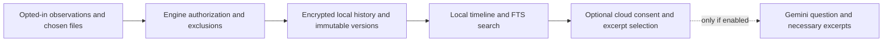

# Security and privacy requirements

Rasit owns security decisions and backend authorization. This document distinguishes enforced starter behavior from future release requirements. [Electron security guidance](https://www.electronjs.org/docs/latest/tutorial/security) informs the process boundary.

## Enforced in the starter

- No collectors, file watchers, snapshot operations, database, article extraction, browser transport, or cloud requests run. Starting an in-memory session does not grant consent or enable monitoring.
- The renderer is sandboxed and isolated without Node integration. Only session capabilities cross preload; arguments, responses, and events are validated. Main authorizes the sender, main frame, and expected page.
- Packaged UI assets use a bounded custom protocol and CSP; external navigation, popup windows, webviews, and permission grants are denied. Renderer code cannot access secrets or privileged filesystem operations.
- The extension requests no page/tab/native permissions, contains no active collection listeners, and forbids incognito use. No user activity is stored in the extension.
- `.env`/database/build outputs are ignored. No real keys are required or committed. Operational startup logging uses a code without sensitive contents.

These controls do not constitute implemented data-at-rest encryption or an audited production security system. Electron/Chromium may maintain ordinary application cache/config files; Rewind has no activity-history or snapshot store yet.

## Consent and lifecycle requirements

Before real collection, show exactly which data is captured, protected-folder scope, exclusions, optional page text/cloud sharing, retention/quota behavior, and clear status controls. Consent is separate from an Active session and can be revoked. Collection must be visible in window/tray, off by default, and never enabled silently on startup, reconnect, update, or worker restart.

Pause/end/revocation must stop collectors, close subscriptions, quiesce queues, invalidate a generation/capability, and reject stale ingestion. Quit must fail safely. Locked/idle behavior must be explicitly specified and tested. An extension flag alone is insufficient: the engine rechecks permissions, active session, source, scope, and payload limits on every ingestion batch. Exclusion changes need explicit treatment of queued/previously captured content.

No keystrokes, clipboard, automatic screenshots, audio/screen recording, hidden monitoring, or arbitrary private/incognito tab access. Optional Readability extraction requires a separate allowed site permission and uses bounded plain text from a cloned DOM. Treat all window titles, URLs, documents, model responses, and extracted content as untrusted data. Render text safely; never evaluate HTML or document scripts.

## Data flow and storage

The arrows above are the planned production flow, not currently running services. Original bytes, metadata, extracted text, search indexes, temporary previews, recovery safety copies, and diagnostic buffers all fall within the privacy design. Do not log sensitive titles, URLs, paths, questions, or document contents by default. Measure operational counts/codes without collecting content. Sanitize query strings/URL secrets before capture under an approved policy.

All history/file copies stay local. Local filesystem scopes need canonicalization, allowed-root checks, file identity verification, reparse/symlink defenses, file-type/size limits, race checks, and bounded parsing. Do not trust a path or file ID just because it came from a renderer, model, extension, or stored record. Parse untrusted documents in bounded background jobs and treat extraction failures as unsupported/gaps.

## Encryption and keys: release gate

Use a reviewed encryption-enabled SQLite build with FTS5 plus authenticated encrypted immutable snapshots and OS-protected keys. Exact binding/build, cipher format, licensing, key hierarchy/rotation/recovery, and Windows packaging are open decisions. A feasibility spike must test the exact Electron ABI, native rebuild, packaged launch, migration/journal/temp/FTS coverage, wrong-key behavior, crash recovery, and tamper detection before approval. SQLCipher is a candidate, not an installed dependency. [SQLCipher documentation](https://www.zetetic.net/sqlcipher/documentation/)

Never silently fall back to plaintext when encryption, credentials, or the OS key store fail. Keep keys out of renderer code, browser storage, `VITE_*`, logs, Git, and ordinary `.env` files. Future user-provided Gemini keys belong in privileged OS-protected storage; no shared provider key is embedded in a distributed app. ASAR, hashes, and file permissions do not provide encryption.

## Retention, deletion, and quotas

Initial retention is 72 hours, configurable. A proposed 2 GiB starter setting is a design default, not an implemented quota. Keep pins checkpoint resources transitively; deleting/unkeeping releases references safely. Expiration and user deletion must reach history records, FTS/derived text, blobs, unreferenced safety copies, previews/temp files, extension buffers, queue contents, diagnostics, and assistant evidence caches.

Cleanup must preserve referential integrity and kept artifacts, reconcile failures after restart, report storage pressure, and stop unsafe capture rather than silently corrupt/delete kept history. WAL/journals and stale files require explicit maintenance. Do not promise forensic erasure from SSDs, independent backups, or copies outside Rewind's store. [SQLite WAL](https://www.sqlite.org/wal.html), [secure_delete](https://www.sqlite.org/pragma.html#pragma_secure_delete)

## Optional Gemini and evidence

Gemini is unimplemented and off until a separate explicit opt-in. Local timeline/keyword search/recovery must work without cloud AI. The future adapter uses official `@google/genai`, one bounded assistant, validated tool inputs/outputs, result limits, cancellation/timeouts, and citations to existing evidence. Never let a model invent proof of a file identity or successful capture.

Send only the user's necessary question and retrieved permitted excerpts, with a clear disclosure of what can leave the device. Excluded/private data cannot become an assistant retrieval bypass. Provider retention/processing terms require review when enabling the feature; Rewind's local retention cannot guarantee deletion by an external AI provider. [Gemini API terms](https://ai.google.dev/gemini-api/terms)

## Recovery safety

Recovery is a user-controlled engine workflow: validate source ID and captured hash → preview → select destination/mode → engine-owned expiring proposal → explicit user confirmation → revalidate → publish recovered copy. Saving a new copy is the default. For overwrite, first preserve the current file in a verified safety version, then recheck target identity/concurrent changes before an atomic replacement where appropriate. If any preservation/check step fails, abort without overwriting.

Never expose generic write paths or an execute/confirm-recovery tool to AI. A model can propose an existing version; the application independently enforces confirmation, permissions, expiry/single-use, path scope, integrity, and current-file preservation. Test malicious paths/reparse points, collisions, deleted/expired versions, locked/changing files, full disks, corruption, revoked permissions, duplicate confirmations, and crashes between steps.

## Release evidence required

Windows packaged native integration; consent/off/pause/end/lock/restart races; excluded/private browser behavior in Chrome and Edge; encrypted DB/blob/key failure tests; local retention/deletion including kept resources; accurate evidence citations; bounded provider requests; safe recovery and interruption tests; signed installer and host registration/uninstall; dependency/license review. None of those future claims is implied by the starter's session tests.
