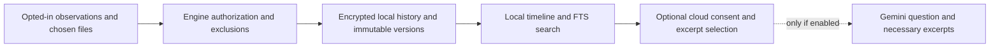

# Security and privacy requirements

Rasit owns security decisions and backend authorization. This document distinguishes the current local implementation from remaining release requirements. The [core integration report](audit/core-functionality-integration.md) and ADRs 0010-0030 record evidence and limitations. [Electron security guidance](https://www.electronjs.org/docs/latest/tutorial/security) informs the process boundary.

## Enforced in this local development branch

- Windows, selected-folder and browser collection start off, require independent explicit approvals and an active session, and expire on app/worker restart. Browser collection also requires extension approval. Exclusions persist; changes pause without automatic resume. Idle/lock and article extraction remain unavailable.
- The renderer is sandboxed without Node. Explicit session, history, files, recovery, checkpoint, browser, storage and assistant capabilities validate arguments, responses and events. Main authorizes exact sender, main frame and page. No raw IPC, generic filesystem or plaintext key API is exposed.
- SQL, collectors, file verification and the optional SDK run in a supervised utility process. It opens only a verified encrypted store; main supplies Windows-protected key access. Generation fencing, stop/drain, deadlines and heartbeat leases prevent silent continuation after lost authority.
- Packaged UI assets use a bounded custom protocol and CSP; external navigation, popup windows, webviews, and permission grants are denied. Renderer code cannot access secrets or privileged filesystem operations.
- The normal MV3 extension requests tabs, nativeMessaging and storage. It never enables private/incognito collection or page extraction. Only a random nonsecret profile tag persists in extension storage; metadata queues and approvals are bounded and ephemeral. Query strings/fragments are removed, and native/engine peer proofs independently authorize each source event.
- Cloud use starts off. Key configuration uses sealed native-to-utility entry and encrypted operational storage; it grants no cloud authority. A separate launch grant and an explicit immutable per-question evidence review are required. Model tools cannot write, delete or confirm recovery.
- `.env`/database/build outputs are ignored. No live key is required or committed. Operational logging uses structured codes without source text, titles, full URLs/paths or keys. Explicit fixture constants are synthetic, isolated and never a normal-profile fallback.

History, FTS, retained original-byte blobs and operational credentials use the cipher database. This is not an independent security audit or production release. Electron/Chromium maintain ordinary cache/config files. Same-user malware, process memory, OS paging/crash dumps and independent backups remain outside the at-rest protection claim. Explicitly exported recovery/preservation files are ordinary files outside encrypted-history retention/deletion. Automated tests use marked temporary synthetic profiles and never capture personal activity or real browsing history.

## Consent and lifecycle requirements

Before real collection, show exactly which data is captured, protected-folder scope, exclusions, optional page text/cloud sharing, retention/quota behavior, and clear status controls. Consent is separate from an Active session and can be revoked. Collection must be visible in window/tray, off by default, and never enabled silently on startup, reconnect, update, or worker restart.

Pause/end/revocation must stop collectors, close subscriptions, quiesce queues, invalidate a generation/capability, and reject stale ingestion. Quit must fail safely. Locked/idle behavior must be explicitly specified and tested. An extension flag alone is insufficient: the engine rechecks permissions, active session, source, scope, and payload limits on every ingestion batch. Exclusion changes need explicit treatment of queued/previously captured content.

No keystrokes, clipboard, automatic screenshots, audio/screen recording, hidden monitoring, or arbitrary private/incognito tab access. Optional Readability extraction requires a separate allowed site permission and uses bounded plain text from a cloned DOM. Treat all window titles, URLs, documents, model responses, and extracted content as untrusted data. Render text safely; never evaluate HTML or document scripts.

## Data flow and storage

The observation → authorization → encrypted history/bytes → local query/recovery path is implemented for Windows activity, selected-folder saved versions and authenticated Chrome/Edge metadata. Optional cloud questions use separately reviewed recorded metadata; document/page extraction remains unavailable. Do not log titles, URLs, paths, questions or document contents. Operational failures expose structured codes and sanitized messages.

History and recovery files stay local. Only explicitly approved question/evidence metadata leaves for Gemini. Native filesystem operations enforce canonicalization, allowed roots, current identities, reparse/link/sharing defenses, size limits and race checks. A stored path or file ID is never an authorization token. Future document parsing belongs in bounded background jobs; unsupported rendering/extraction is disclosed.

## Encryption and keys: release gate

The local implementation selects `better-sqlite3-multiple-ciphers` 13.1.1, SQLCipher-profile authenticated encryption and Windows DPAPI-protected random keys; see [ADR 0010](decisions/0010-encrypted-recording-store.md). Packaged Windows reopen, encrypted original bytes, DB/WAL/FTS, credentials, wrong-key, migration, corruption and key-failure tests pass. The binding is SQLite3 Multiple Ciphers, not a claim of Zetetic support or FIPS certification. Key rotation/recovery, dependency/license notices and independent review remain release gates.

Never silently fall back to plaintext when encryption, credentials, or the OS key store fail. Keep keys out of renderer code, browser storage, `VITE_*`, logs, Git, and ordinary `.env` files. User-provided Gemini keys stay in the existing encrypted store under the Windows-protected database key. Native entry seals directly to the utility's short-lived recipient; main/preload/renderer never receive a plaintext key. No shared provider key is embedded. ASAR, hashes, and file permissions do not provide encryption.

## Retention, deletion, and quotas

The defaults are 72 hours and 2 GiB, with configurable retention and physical database/journal usage tracking. Startup/query/periodic cleanup expires unkept evidence, reconciles FTS/blobs and applies bounded oldest-first quota eviction. Keep protects actual checkpoint evidence transitively. Explicit maintenance stops/drains capture and revokes launch approvals; confirmed deletion distinguishes kept evidence. Actual removals invalidate assistant authority synchronously before commit, and cached reviews/answers expire on both clocks. Ordinary exported copies, preservation files and provider-held data are outside local deletion. Quotas are backpressure, not filesystem hard caps, and bounded writes/compaction can temporarily exceed them.

Cleanup must preserve referential integrity and kept artifacts, reconcile failures after restart, report storage pressure, and stop unsafe capture rather than silently corrupt/delete kept history. WAL/journals and stale files require explicit maintenance. Do not promise forensic erasure from SSDs, independent backups, or copies outside Rewind's store. [SQLite WAL](https://www.sqlite.org/wal.html), [secure_delete](https://www.sqlite.org/pragma.html#pragma_secure_delete)

## Optional Gemini and evidence

Gemini is optional and off until a separate launch opt-in plus explicit per-question sharing approval. Local timeline, keyword search and recovery work without it. The official `@google/genai` adapter has one bounded read-only tool over a reviewed immutable pool, two bounded calls, strict response/citation validation, time/byte/request limits and observed cancellation. Actual retained sources, checkpoint-aware retention and current exclusions are reverified before transmission/publication. A key echoed in a provider answer is rejected. A source integrity failure faults the service; an invalid provider response does not become an answer. No model can prove an inferred file path or execute recovery/deletion.

The current interface answers only over one to twelve selected saved observations; it does not share page text, captured file contents or full paths. Settings/Search are verified through the actual packaged boundary with an offline provider and synthetic sealed input. Positive interactive native entry and live-account compatibility remain manual acceptance gates; see [ADR 0030](decisions/0030-public-reviewed-gemini-questions.md).

Send only the user's necessary question and retrieved permitted excerpts, with a clear disclosure of what can leave the device. Excluded/private data cannot become an assistant retrieval bypass. Provider retention/processing terms require review when enabling the feature; Rewind's local retention cannot guarantee deletion by an external AI provider. [Gemini API terms](https://ai.google.dev/gemini-api/terms)

## Recovery safety

Recovery uses actual retained bytes, preview, a main-owned native destination dialog, an expiring engine proposal and explicit user confirmation. Saving a new copy is primary. Optional overwrite separately verifies current target identity/hash/write time and requires exclusive handle/oplock admission. A new ordinary preservation file is fully flushed and verified before target mutation. Failed prerequisites leave the target unchanged; failed writes attempt verified rollback and retain the preservation file. An interrupted write can leave an incomplete target, so this is not an atomic replacement or a power-loss transaction. The preservation file is outside encrypted-history retention/deletion and remains available for manual recovery. See ADR 0024. AI has no execution/confirmation capability.

Never expose generic write paths or an execute/confirm-recovery tool to AI. A model can propose an existing version; the application independently enforces confirmation, permissions, expiry/single-use, path scope, integrity, and current-file preservation. Test malicious paths/reparse points, collisions, deleted/expired versions, locked/changing files, full disks, corruption, revoked permissions, duplicate confirmations, and crashes between steps.

## Release evidence required

The core report records current Windows/native/browser, consent/lifecycle, encrypted DB/blob/key failure, retention/deletion/Keep, citations, bounded SDK and recovery failure evidence. Remaining release gates include independent security review, idle/lock and broader version-one work, manual native-entry/live-account acceptance, provider policy/account review, signing/installer/update/uninstall behavior and dependency/license reconciliation. A packaged executable and local regression tests do not certify a release.
