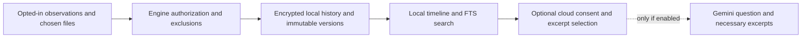

# Security and privacy requirements

Rasit owns security decisions and backend authorization. This document distinguishes enforced starter behavior from future release requirements. [Electron security guidance](https://www.electronjs.org/docs/latest/tutorial/security) informs the process boundary.

## Enforced in this local development branch

- Collection starts off and requires explicit Windows approval plus an active session. Approval expires on each app/worker restart. Exclusions persist; changes pause without automatic resume. Browser/folder collection, snapshots, extraction and cloud requests are unavailable.
- The renderer is sandboxed without Node. Session/runtime/privacy/history/timeline capabilities validate arguments, responses and events. Main authorizes exact sender, main frame and page. No raw IPC/filesystem/key API is exposed.
- SQL and the Windows collector run in a supervised utility process. It opens only a verified encrypted store; main supplies Windows-protected key access. Generation fencing, stop/drain, deadlines and heartbeat leases prevent silent continuation after lost authority.
- Packaged UI assets use a bounded custom protocol and CSP; external navigation, popup windows, webviews, and permission grants are denied. Renderer code cannot access secrets or privileged filesystem operations.
- The extension requests no page/tab/native permissions, contains no active collection listeners, and forbids incognito use. No user activity is stored in the extension.
- `.env`/database/build outputs are ignored. No real keys are required or committed. Operational startup logging uses a code without sensitive contents.

The local history store is encrypted; this is not an independent security audit or production release. Electron/Chromium maintain ordinary cache/config files. Same-user malware, process memory, OS paging/crash dumps and independent backups remain outside the at-rest protection claim. Snapshots are not implemented. Automated tests use marked temporary synthetic profiles and never query real foreground activity.

## Consent and lifecycle requirements

Before real collection, show exactly which data is captured, protected-folder scope, exclusions, optional page text/cloud sharing, retention/quota behavior, and clear status controls. Consent is separate from an Active session and can be revoked. Collection must be visible in window/tray, off by default, and never enabled silently on startup, reconnect, update, or worker restart.

Pause/end/revocation must stop collectors, close subscriptions, quiesce queues, invalidate a generation/capability, and reject stale ingestion. Quit must fail safely. Locked/idle behavior must be explicitly specified and tested. An extension flag alone is insufficient: the engine rechecks permissions, active session, source, scope, and payload limits on every ingestion batch. Exclusion changes need explicit treatment of queued/previously captured content.

No keystrokes, clipboard, automatic screenshots, audio/screen recording, hidden monitoring, or arbitrary private/incognito tab access. Optional Readability extraction requires a separate allowed site permission and uses bounded plain text from a cloned DOM. Treat all window titles, URLs, documents, model responses, and extracted content as untrusted data. Render text safely; never evaluate HTML or document scripts.

## Data flow and storage

The observation → authorization → encrypted metadata → local history/FTS path is implemented for Windows foreground activity. File-copy/extraction/cloud paths remain planned. Do not log titles, URLs, paths, questions or document contents. Operational failures expose structured codes and sanitized messages. Browser URL policy currently exists only as tested inactive transport groundwork.

All history/file copies stay local. Local filesystem scopes need canonicalization, allowed-root checks, file identity verification, reparse/symlink defenses, file-type/size limits, race checks, and bounded parsing. Do not trust a path or file ID just because it came from a renderer, model, extension, or stored record. Parse untrusted documents in bounded background jobs and treat extraction failures as unsupported/gaps.

## Encryption and keys: release gate

The local implementation selects `better-sqlite3-multiple-ciphers` 13.1.1, SQLCipher-profile authenticated encryption and Windows DPAPI-protected random keys; see [ADR 0010](decisions/0010-encrypted-recording-store.md). Packaged Windows reopen and synthetic DB/WAL/FTS, wrong-key, migration, corruption and key-failure tests pass. The binding is SQLite3 Multiple Ciphers, not a claim of Zetetic support or FIPS certification. Snapshot encryption, key rotation/recovery, full dependency notices and independent review remain release gates.

Never silently fall back to plaintext when encryption, credentials, or the OS key store fail. Keep keys out of renderer code, browser storage, `VITE_*`, logs, Git, and ordinary `.env` files. Future user-provided Gemini keys belong in privileged OS-protected storage; no shared provider key is embedded in a distributed app. ASAR, hashes, and file permissions do not provide encryption.

## Retention, deletion, and quotas

The design default is 72 hours and a proposed 2 GiB quota. Automatic expiration/deletion and full quota orchestration are not implemented; the UI discloses this before approval and permits only development use. The native store has a database page cap, which is not a complete disk/WAL quota. Future Keep pins checkpoint resources transitively. Expiration/deletion must reach records, FTS, blobs, safety copies, previews, extension buffers, queues, diagnostics and assistant caches.

Cleanup must preserve referential integrity and kept artifacts, reconcile failures after restart, report storage pressure, and stop unsafe capture rather than silently corrupt/delete kept history. WAL/journals and stale files require explicit maintenance. Do not promise forensic erasure from SSDs, independent backups, or copies outside Rewind's store. [SQLite WAL](https://www.sqlite.org/wal.html), [secure_delete](https://www.sqlite.org/pragma.html#pragma_secure_delete)

## Optional Gemini and evidence

Gemini is unimplemented and off until a separate explicit opt-in. Local timeline/keyword search/recovery must work without cloud AI. The future adapter uses official `@google/genai`, one bounded assistant, validated tool inputs/outputs, result limits, cancellation/timeouts, and citations to existing evidence. Never let a model invent proof of a file identity or successful capture.

Send only the user's necessary question and retrieved permitted excerpts, with a clear disclosure of what can leave the device. Excluded/private data cannot become an assistant retrieval bypass. Provider retention/processing terms require review when enabling the feature; Rewind's local retention cannot guarantee deletion by an external AI provider. [Gemini API terms](https://ai.google.dev/gemini-api/terms)

## Recovery safety

Recovery uses actual retained bytes, preview, a main-owned native destination dialog, an expiring engine proposal and explicit user confirmation. Saving a new copy is primary. Optional overwrite separately verifies current target identity/hash/write time and requires exclusive handle/oplock admission. A new ordinary preservation file is fully flushed and verified before target mutation. Failed prerequisites leave the target unchanged; failed writes attempt verified rollback and retain the preservation file. An interrupted write can leave an incomplete target, so this is not an atomic replacement or a power-loss transaction. The preservation file is outside encrypted-history retention/deletion and remains available for manual recovery. See ADR 0024. AI has no execution/confirmation capability.

Never expose generic write paths or an execute/confirm-recovery tool to AI. A model can propose an existing version; the application independently enforces confirmation, permissions, expiry/single-use, path scope, integrity, and current-file preservation. Test malicious paths/reparse points, collisions, deleted/expired versions, locked/changing files, full disks, corruption, revoked permissions, duplicate confirmations, and crashes between steps.

## Release evidence required

Windows packaged native integration; consent/off/pause/end/lock/restart races; excluded/private browser behavior in Chrome and Edge; encrypted DB/blob/key failure tests; local retention/deletion including kept resources; accurate evidence citations; bounded provider requests; safe recovery and interruption tests; signed installer and host registration/uninstall; dependency/license review. None of those future claims is implied by the starter's session tests.
